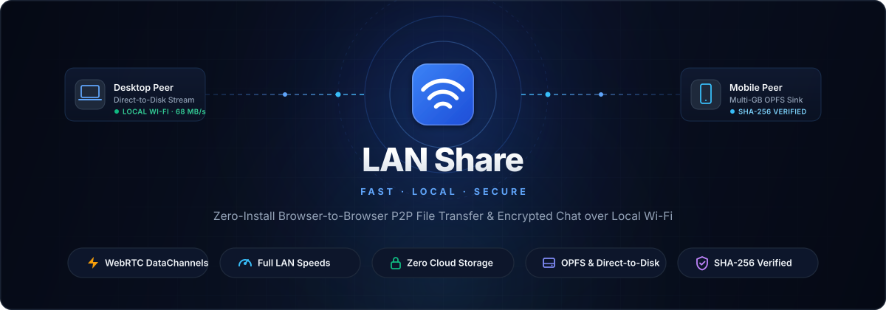
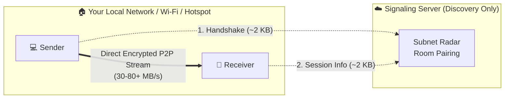
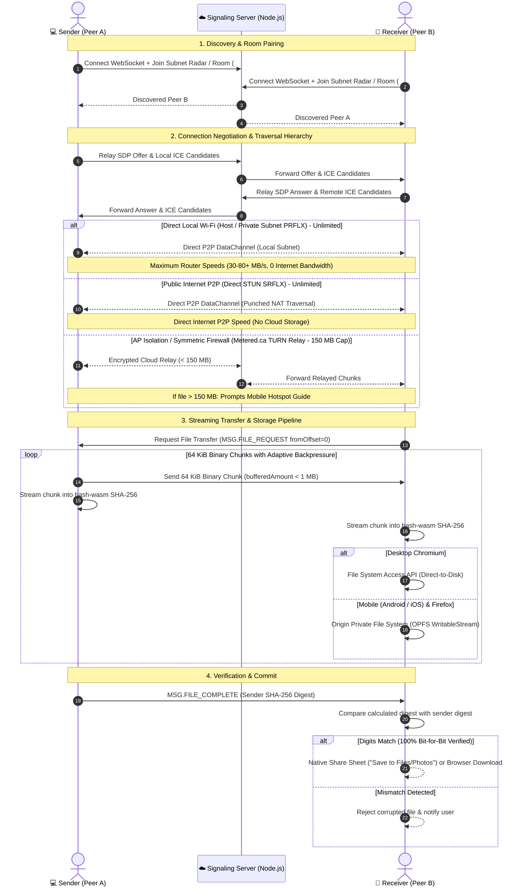

<div align="center">

# 📡 LAN Share

**Direct browser-to-browser P2P file transfer and chat on local Wi-Fi, powered by WebRTC with no cloud storage, mobile multi-GB OPFS streaming, and zero-corrupt WebAssembly SHA-256 verification.**

[](LICENSE)
[](https://lan-share.vercel.app/)
[](#quality-assurance--automated-testing)
[](https://react.dev/)
[](https://vitejs.dev/)
[](https://webrtc.org/)
[](https://developer.mozilla.org/en-US/docs/Web/API/File_System_API/Origin_private_file_system)
[](https://github.com/Daninet/hash-wasm)
[](docker-compose.yml)
[](https://github.com/bilalzulfiqar-pk/lan-share/pulls)

<br />



<br />

**[🚀 Open Live App](https://lan-share.vercel.app/)** • **[⚡ Quickstart](#quickstart-in-3-commands)** • **[🔍 Architecture](#architecture--how-it-works)** • **[🛠️ Self-Hosting](#self-hosting--deployment)**

</div>

---

<details>
<summary><b>📑 Table of Contents (Click to Expand)</b></summary>

- [Overview](#overview)
- [Key Features](#key-features)
  - [Core Transfer Engine & Storage](#core-transfer-engine--storage)
  - [Networking & NAT Resilience](#networking--nat-resilience)
  - [Session UX & Privacy](#session-ux--privacy)
- [Architecture & How It Works](#architecture--how-it-works)
  - [Simple Architecture Diagram](#simple-architecture-diagram)
  - [Deep-Dive WebRTC Lifecycle Diagram](#deep-dive-webrtc-lifecycle-diagram)
  - [Connection Stages Breakdown](#connection-stages-breakdown)
- [Network Resilience & Difficult Wi-Fi Handling](#network-resilience--difficult-wi-fi-handling)
  - [Understanding Access Point (AP) Isolation](#understanding-access-point-ap-isolation)
  - [University & Enterprise VLAN Segmentation](#university--enterprise-vlan-segmentation)
  - [6-Digit Room Codes & Shareable URL Hashes](#6-digit-room-codes--shareable-url-hashes)
  - [Metered.ca Ephemeral TURN Relay (150 MB Cap)](#meteredca-ephemeral-turn-relay-150-mb-cap)
  - [The Mobile Hotspot Trick (Full 50+ MB/s Speed)](#the-mobile-hotspot-trick-full-50-mbs-speed)
- [Quickstart (In 3 Commands)](#quickstart-in-3-commands)
  - [Option A: Local Development (Node.js & npm)](#option-a-local-development-nodejs--npm)
  - [Option B: Docker Compose](#option-b-docker-compose)
- [Browser Compatibility & Storage Engines](#browser-compatibility--storage-engines)
- [Tech Stack](#tech-stack)
- [Self-Hosting & Deployment](#self-hosting--deployment)
  - [1. Client Deployment (Vercel / Netlify / Cloudflare Pages)](#1-client-deployment-vercel--netlify--cloudflare-pages)
  - [2. Signaling Server Deployment (Render / Railway / Fly.io / VPS)](#2-signaling-server-deployment-render--railway--flyio--vps)
  - [3. Free TURN Relay Setup (Metered.ca)](#3-free-turn-relay-setup-meteredca)
  - [Environment Variables Reference](#environment-variables-reference)
- [Quality Assurance & Automated Testing](#quality-assurance--automated-testing)
- [Project Structure](#project-structure)
- [Contributing](#contributing)
- [License](#license)

</details>

---

## Overview

**LAN Share** is an open-source, private, cross-platform file transfer and messaging application built entirely on modern web standards. It enables direct peer-to-peer data streaming between smartphones, tablets, laptops, and desktop computers without installing native apps, registering user accounts, or uploading files to third-party cloud servers.

Transfers travel over direct WebRTC DataChannels at physical router speeds (30-80+ MB/s on 5 GHz Wi-Fi). Multi-gigabyte files stream directly to disk without exhausting browser RAM, and every payload is cryptographically verified down to the exact bit using streaming WebAssembly SHA-256 digests.

---

## Key Features

### Core Transfer Engine & Storage
- **Direct LAN Speeds (30-80+ MB/s):** Transfers stream peer-to-peer over DTLS-encrypted WebRTC DataChannels at physical router speeds with zero internet bandwidth consumption.
- **Zero-RAM-Crash Disk Streaming:** Streams directly to disk on desktop via the native File System Access API and on mobile (iOS/Android) via the Origin Private File System (OPFS), maintaining a flat <20 MB RAM footprint even on 10+ GB transfers.
- **Streaming WebAssembly SHA-256:** Cryptographically verifies files on-the-fly chunk-by-chunk using hardware-accelerated WebAssembly (`hash-wasm`), guaranteeing 100% bit-for-bit file integrity.

### Networking & NAT Resilience
- **Dual Discovery Modes:** Automatic real-time discovery on local Wi-Fi via Subnet Radar, plus instant 6-digit room codes and QR pairing across segmented campus VLANs, guest networks, or cellular data.
- **Extender & Hotspot Resilience:** Automatic RFC 1918 peer-reflexive (`prflx`) classification across Wi-Fi repeaters, W3C Perfect Negotiation to prevent simultaneous-offer glare, and 3-second automatic ICE recovery.
- **Transparent Connection Diagnostics:** Live badge diagnostics (`Local Wi-Fi Transfer`, `Direct Internet Transfer`, `Cloud Relay Transfer`) with interactive popovers explaining network topology and 150 MB relay quota caps.

### Session UX & Privacy
- **Ephemeral P2P Encrypted Chat:** Send end-to-end encrypted messages, URLs, notes, and code snippets directly between devices with markdown auto-linking and one-tap copy, stored strictly in volatile memory.
- **Intelligent Alerts & Screen Wake Lock:** Adaptive audio cues play in the foreground, while background Android tabs and desktop browsers trigger native system notifications via Service Worker, with `navigator.wakeLock` preventing mobile sleep mid-transfer.
- **15 Built-in Themes:** High-contrast presets (Cyberpunk, Tokyo Neon, Dracula, Nord, Ocean, Midnight, and minimalist modes) with automatic dynamic favicon generation and browser theme-color synchronization.

---

## Architecture & How It Works

LAN Share strictly separates discovery and signaling from file data transmission. **File payloads never touch or pass through the signaling server.**

### Simple Architecture Diagram



1. **Local Network Discovery (~2 KB):** Devices discover each other automatically on your local Wi-Fi subnet radar, or connect across guest networks/VLANs via 6-digit room codes (`#room=123456`) or camera QR scans.
2. **Zero Cloud Uploads:** The signaling server solely relays lightweight (~2 KB) cryptographic session descriptions (SDP) and ICE candidates. File contents never touch, pass through, or get stored on any cloud server or database.
3. **Maximum Direct LAN Speed:** Once paired, browsers establish a direct DTLS-encrypted WebRTC `RTCDataChannel`, streaming payloads directly at physical router speed (30-80+ MB/s).

<br />

### Deep-Dive WebRTC Lifecycle Diagram

<details>
<summary><b>🔍 Deep-Dive: Complete WebRTC Lifecycle & Storage Architecture Diagram (Click to Expand)</b></summary>
<br />



</details>

### Connection Stages Breakdown

1. **Signaling Server (Kept Warm 24/7):**
   Hosted on Render and kept continuously awake via an external ping monitor. It only brokers small (~2 KB) SDP offers, answers, and ICE candidates over WebSockets. The frontend automatically issues a lightweight `/health` probe on startup to wake sleeping instances with real-time UI status updates.
2. **Subnet Radar vs. Room Pairing:**
   Peers on simple home routers auto-cluster by public IP and subnet fingerprints (`SimilarityIndex`). When subnets are split, entering a 6-digit room code or opening `#room=123456` groups peers regardless of network topology.
3. **P2P Establishment & Candidate Prioritization:**
   WebRTC probes host (direct LAN), peer-reflexive (`prflx`), server-reflexive (STUN), and relay (TURN) candidates. Direct local subnet communication is prioritized for maximum physical throughput.
4. **Chunked Streaming Engine with Backpressure:**
   Files are sliced into 64 KiB ArrayBuffers. If `bufferedAmount` exceeds 1 MB, sender transmission pauses until the `onbufferedamountlow` event fires, preventing memory accumulation or network packet drops.
5. **Direct Storage Sinks (Desktop vs. Mobile):**
   - **Chromium Desktop:** Chunks write directly to disk through `FileSystemFileHandle.createWritable()`.
   - **Mobile (Safari & Android Chrome):** Chunks write incrementally into the Origin Private File System (`navigator.storage.getDirectory()`), capping RAM consumption below 20 MB even for 10+ GB transfers.
6. **Bit-for-Bit Hash Verification:**
   Sender and receiver calculate SHA-256 digests incrementally in WebAssembly. The file is only committed if the hashes match down to the exact bit.

---

## Network Resilience & Difficult Wi-Fi Handling

Peer-to-peer browser applications face significant real-world challenges on institutional and public networks. LAN Share is engineered specifically to diagnose and resolve these limitations honestly and transparently.

### Understanding Access Point (AP) Isolation

On public Wi-Fi networks (hotels, airports, cafes, and conference centers), network administrators intentionally enable **Access Point (AP) Isolation** (also called Client Isolation or Station-to-Station traffic blocking).

- **The Problem:** AP isolation allows wireless devices to speak to the default gateway (the Internet), but drops all frames sent directly between two wireless clients on the same BSSID/SSID.
- **How It Manifests:** Both devices can reach the web and signaling server, but WebRTC direct LAN host candidates fail to complete the DTLS handshake.

### University & Enterprise VLAN Segmentation

Campuses (such as `eduroam` or corporate environments) often segregate users across distinct subnets, VLANs, or wireless frequency bands:
- A laptop on `10.104.12.x` cannot broadcast or multicast to a smartphone on `10.104.14.x`.
- Multicast DNS (mDNS) and local broadcast discovery packets are filtered by enterprise switches.

### 6-Digit Room Codes & Shareable URL Hashes

To solve cross-subnet and cross-VLAN segregation without requiring server-side IP tracking:
1. One peer clicks **"Create Room"** to generate a randomized 6-digit room code (or custom alphanumeric string).
2. The second peer types the 6-digit code or scans the displayed QR code.
3. The URL updates with a hash anchor: `https://lan-share.vercel.app/#room=492810`.
4. The signaling server clusters the sockets into that explicit room, enabling peers across different subnets, VLANs, or cellular data to exchange WebRTC session descriptions seamlessly.

### Metered.ca Ephemeral TURN Relay (150 MB Cap)

When AP isolation or symmetric NAT completely blocks direct peer-to-peer UDP traffic, LAN Share automatically fetches ephemeral TURN credentials from **Metered.ca OpenRelay**.
- **Safety Quota Protection:** To preserve the free community relay bandwidth and protect user privacy, relayed transfers are strictly capped at **150 MB**.
- **Strict Local Mode:** Users can toggle "Strict Local Mode" in settings to disable TURN relays completely, guaranteeing that no file data ever leaves the local subnet.

### The Mobile Hotspot Trick (Full 50+ MB/s Speed)

When transferring large files (> 150 MB) on a network with strict AP Isolation or complex campus firewalls, LAN Share opens an interactive **Mobile Hotspot Guide Modal**:

```
+-------------------------------------------------------------+
| 📱 Wi-Fi Direct Blocked by Router Security (AP Isolation)   |
|                                                             |
| 1. Turn on "Personal Hotspot" on your smartphone.           |
| 2. Connect your laptop / receiver to that hotspot Wi-Fi.    |
| 3. Reload LAN Share - transfer at 50+ MB/s with ZERO        |
|    mobile cellular data consumption!                        |
+-------------------------------------------------------------+
```

**Why this works:** The smartphone's hotspot functions as an open local Wi-Fi router without AP isolation. Traffic between the laptop and the phone routes entirely over the local wireless radio at maximum 802.11ac/ax speeds without consuming cellular mobile data.

---

## Quickstart (In 3 Commands)

### Option A: Local Development (Node.js & npm)

Clone the repository and run both client and signaling server locally:

```bash
# 1. Clone the repository
git clone https://github.com/bilalzulfiqar-pk/lan-share.git && cd lan-share

# 2. Start the signaling server (Terminal 1)
npm install --prefix server && npm run dev --prefix server

# 3. Start the client application (Terminal 2)
npm install --prefix client && npm run dev --prefix client
```

Open `http://localhost:5173` on your computer and open the printed Network IP address on your phone or second device!

---

### Option B: Docker Compose

Spin up the entire stack with a single containerized command:

```bash
# 1. Clone the repository
git clone https://github.com/bilalzulfiqar-pk/lan-share.git && cd lan-share

# 2. Build and launch containers
docker compose up --build

# 3. Open in your browser
open http://localhost:5173
```

---

## Browser Compatibility & Storage Engines

LAN Share dynamically selects the best storage engine supported by the user's browser environment:

| Feature / Engine | Chrome / Edge (Desktop) | Safari (iOS & macOS) | Android Chrome | Firefox |
| :--- | :---: | :---: | :---: | :---: |
| **Subnet Radar Discovery** | ✅ Full | ✅ Full | ✅ Full | ✅ Full |
| **6-Digit Room & QR Pairing** | ✅ Full | ✅ Full | ✅ Full | ✅ Full |
| **Storage Sink Strategy** | **File System Access API**<br/>(Direct-to-Disk) | **OPFS WritableStream**<br/>(Origin Private File System) | **OPFS WritableStream**<br/>(Origin Private File System) | **OPFS WritableStream**<br/>(Origin Private File System) |
| **Multi-GB Transfers** | ✅ Unlimited | ✅ Multi-GB (Zero RAM crash) | ✅ Multi-GB (Zero RAM crash) | ✅ Multi-GB |
| **Streaming SHA-256 (Wasm)** | ✅ Hardware accelerated | ✅ Hardware accelerated | ✅ Hardware accelerated | ✅ Hardware accelerated |
| **Screen Wake Lock** | ✅ Supported | ✅ Supported | ✅ Supported | ⚠️ Audio beacon fallback |
| **Native Save / Share Sheet** | ✅ Direct folder save | ✅ "Save to Photos / Files" | ✅ "Save to Downloads" | ✅ Direct file save |
| **PWA Installation** | ✅ Supported | ✅ Add to Home Screen | ✅ Supported | ⚠️ Limited |
| **Smart Hybrid Alerts** | ✅ Native OS Banners | ✅ Sound Chime (PWA Banner) | ✅ Service Worker Banners | ✅ Native OS Banners |

---

## Tech Stack

```
lan-share/
├── client/                     # Frontend Application
│   ├── Framework:              React 19, Vite 7
│   ├── Networking:             Native WebRTC (RTCDataChannel), Socket.IO Client
│   ├── Storage & Streaming:    Origin Private File System (OPFS), File System Access API
│   ├── Hashing & Security:     hash-wasm (Streaming WebAssembly SHA-256)
│   ├── Styling & Motion:       Modern CSS Design Tokens, Framer Motion, Inline SVG Icons
│   └── Testing:                Vitest (278 automated tests)
│
└── server/                     # Signaling & Discovery Service
    ├── Runtime:                Node.js 20+, Express 5, Socket.IO 4
    ├── Clustering:             SimilarityIndex Subnet Fingerprinting + Room Registry
    ├── Relay Provider:         Metered.ca OpenRelay REST Integration (1h Caching + Negative TTL)
    └── Testing:                Vitest (70 automated tests)
```

---

## Self-Hosting & Deployment

LAN Share is designed for zero-cost, lightweight self-hosting across modern cloud providers:

### 1. Client Deployment (Vercel / Netlify / Cloudflare Pages)
- **Root Directory:** `client`
- **Build Command:** `npm run build`
- **Output Directory:** `dist`
- **Environment Variables:**
  - `VITE_SERVER_URL`: URL of your deployed signaling service (e.g., `https://your-signal-server.onrender.com`).
  - `VITE_SITE_URL`: Canonical URL for OpenGraph and QR sharing (e.g., `https://lan-share.vercel.app`).

### 2. Signaling Server Deployment (Render / Railway / Fly.io / VPS)
- **Root Directory:** `server`
- **Runtime:** Node.js 20+
- **Build Command:** `npm install`
- **Start Command:** `npm start`
- **Health Check Endpoint:** `GET /health` (returns `{"ok": true}`)
- **Free Render Wake-Up:** The client automatically issues a non-blocking `/health` ping on load to wake free-tier sleeping instances with responsive UI status banners.

### 3. Free TURN Relay Setup (Metered.ca)
To allow small files (<150 MB) to route through AP-isolated networks:
1. Sign up for a free account at [Metered.ca OpenRelay](https://www.metered.ca/tools/openrelay/).
2. Create an application to get your **App Name** and **API Key**.
3. Set the environment variables on your signaling server:
   - `METERED_APP_NAME`: Your Metered application name.
   - `METERED_API_KEY`: Your Metered REST API key.
4. The server automatically handles TTL caching (1-hour in-memory cache), request coalescing, negative caching on upstream rate limits, and fallback to Google & Cloudflare public STUN servers.

### Environment Variables Reference

| Variable | Scope | Required | Description |
| :--- | :---: | :---: | :--- |
| `PORT` | Server | Optional | Port for the signaling service (default: `3001`). |
| `METERED_APP_NAME` | Server | Optional | Metered.ca application name for TURN relay. |
| `METERED_API_KEY` | Server | Optional | Metered.ca REST API key for caching ephemeral TURN credentials. |
| `VITE_SERVER_URL` | Client | Optional | Signaling server URL (default: `http://localhost:3001` or relative origin). |
| `VITE_SITE_URL` | Client | Optional | Canonical site URL for SEO meta and QR sharing (default: `https://lan-share.vercel.app`). |

---

## Quality Assurance & Automated Testing

LAN Share is backed by **348 automated tests** (278 client + 70 server) verifying socket clustering, WebRTC state machines, OPFS streaming fallbacks, TURN relay protection, connection mode diagnostics, and protocol serialization:

```bash
# Run server test suite (clustering, rooms, TURN credential caching)
npm test --prefix server

# Run client test suite (transfer engine, resumption, OPFS, wakeLock, protocols)
npm test --prefix client

# Run client code linter
npm run lint --prefix client

# Run client production build
npm run build --prefix client
```

Key test suites include:
- **`networkScenarios.test.js`:** Simulates direct LAN host pairs, Wi-Fi extender `prflx` candidates, STUN internet traversal, TURN fallback, polite peer glare rollback, and automatic 3-second ICE restarts.
- **`resumptionIntegrity.test.js`:** Tests mid-transfer DataChannel drops, byte-offset resumption, and verifies that corrupted chunks trigger immediate SHA-256 rejection.
- **`relayProtection.test.js`:** Verifies 150 MB file quota blocks on TURN relays and enforces Strict Local Mode candidate stripping.
- **`realServer.test.js`:** Spins up real Node.js socket servers in child processes to test end-to-end multi-peer room isolation and signaling relays.

For detailed manual testing across physical hardware, see the [Manual QA Checklist](docs/QA-CHECKLIST.md).

---

## Project Structure

```
lan-share/
├── client/                     # React 19 + Vite frontend
│   ├── public/                 # Manifest, favicons, audio cues, SEO assets
│   ├── src/
│   │   ├── components/         # Radar, Chat, RoomModal, HotspotGuideModal, ConnectionModeBadge
│   │   ├── hooks/              # useSignaling (Socket.IO), useWebRTC (engine hook)
│   │   └── lib/                # TransferEngine, protocol, opfs, sound, clipboard, notifications, wakeLock
│   │       └── __tests__/      # Vitest client suites (278 tests)
│   ├── package.json
│   └── vite.config.js
├── server/                     # Node.js + Express + Socket.IO signaling service
│   ├── index.js                # Server entry point, TURN endpoint, socket events
│   ├── lib.js                  # Subnet clustering, room registry, SimilarityIndex
│   ├── turn.js                 # Metered.ca credential manager with TTL caching
│   ├── *.test.js               # Vitest server suites (70 tests)
│   └── package.json
├── docs/                       # Project documentation & guides
│   ├── assets/                 # Vector banner & architecture diagrams
│   ├── QA-CHECKLIST.md         # Multi-device QA checklist
│   └── CHANGELOG.md            # Detailed milestone and release notes
├── docker-compose.yml          # Containerized local development stack
└── README.md                   # Repository overview
```

---

## Contributing

Contributions, bug reports, and suggestions are warmly welcomed!

1. **Fork the Repository** on GitHub.
2. **Create a Feature Branch**: `git checkout -b feature/amazing-feature`
3. **Commit Your Changes**: Follow conventional commits (`git commit -m 'feat: add amazing feature'`). Ensure no em-dashes are added to UI copy (use standard hyphens `-` or colons `:` instead).
4. **Run Verification Commands**:
   ```bash
   npm test --prefix client
   npm test --prefix server
   npm run lint --prefix client
   npm run build --prefix client
   ```
5. **Push to Your Branch**: `git push origin feature/amazing-feature`
6. **Open a Pull Request** with a description of your changes and test results.

---

## License

This project is licensed under the [MIT License](LICENSE). Contributions, bug reports, and pull requests are welcome!

---

<div align="center">

**Built with modern WebRTC, React 19, and Vite.**

If you find LAN Share helpful, consider giving it a ⭐ on [GitHub](https://github.com/bilalzulfiqar-pk/lan-share)!

</div>
